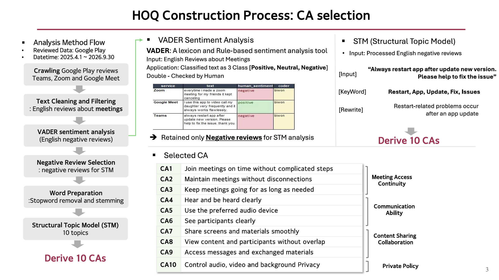

# 화상회의 앱 리뷰에서 Zoom의 개선 우선순위 도출하기

**2026년 2학기 품질경영 - QFD 팀 프로젝트**

_"이어폰을 연결했는데 회의 소리는 스피커에서 나온다. 이 리뷰에서 사용자가 원한 것은 더 선명한 음질일까, 원하는 출력 장치를 선택하는 기능일까?"_

Zoom·Google Meet·Microsoft Teams의 Google Play 리뷰와 자체 진행한 설문조사에서 반복되는 불편을 찾고, 이용자가 원하는 결과를 기술적 특성과 연결해 Zoom(Our Service)의 개선 우선순위를 제안했다.

  

## 역할

팀원이 수집한 리뷰를 받아 Python 전처리·감정분류와 R 토픽 분석 흐름을 구성하고 활용했다.  
본문 언어와 회의 맥락을 기준으로 표본을 선별하고, 토픽의 핵심어를 대표 원문과 대조해 고객 요구사항(CA) 후보와 근거를 정리했다. 
감정분류 검토용 리뷰 102개를 직접 읽고 라벨링했다. 방법론 보고서를 정리하고 일부 기술적 특성(EC)의 근거 조사, 서비스 간 벤치마킹 정리, 결론 구성에도 참여했다.
  

  

## 리뷰에서 확인한 내용

| 질문 | 분석 결과 |
| --- | --- |
|➀ 어떤 이용 경험을 분석했나? | 입력 98,361건 중 영어이며 회의 맥락이 명시된 리뷰는 6,024건이었다. 부정 판정과 어휘 정제를 거친 1,288건으로 구조적 토픽 모형(STM)을 학습했다. |
|➁ 자동 선별에서 어떤 불만이 빠질 수 있나? | 별도 수동 검토 표본에서 사람이 부정으로 읽은 77건 중 VADER가 찾은 것은 42건이었다. 부정 정밀도는 91.3%, 재현율은 54.5%였다. |
|➂ 단어를 어떻게 고객 요구로 해석했나? | 토픽별 핵심어와 서비스별 대표 원문 300행(고유 리뷰 298건)을 대조했다. 오디오 출력 장치 선택 실패를 ‘원하는 오디오 기기로 듣고 말할 수 있다’는 요구로 해석한 것이 한 사례다. |
 

자동 선별로 빠질 수 있는 경험도 고려해 CA 해석에는 영어 긍정·중립 리뷰와 한국어 원문을 보완 자료로 사용했다. 이후 후보를 검토해 최종 CA 10개를 채택했다. 
 

| - | -  |  -|
|---|---|---|
| CA1 | Join meetings on time without complicated steps | 복잡한 절차 없이 제시간에 회의에 참여할 수 있다 |
| CA2 | Maintain meetings without disconnections | 연결이 끊어지지 않고 회의를 이어갈 수 있다 |
| CA3 | Keep meetings going for as long as needed | 필요한 시간만큼 회의를 지속할 수 있다 |
| CA4 | Hear and be heard clearly | 상대방의 말을 또렷이 듣고 내 목소리도 명확히 전달할 수 있다 |
| CA5 | Use the preferred audio device | 원하는 오디오 기기로 듣고 말할 수 있다 |
| CA6 | See participants clearly | 참가자의 모습을 선명하게 볼 수 있다 |
| CA7 | Share screens and materials smoothly | 화면과 자료를 원활하게 공유할 수 있다 |
| CA8 | View content and participants without overlap | 공유 콘텐츠와 참가자를 겹치지 않게 볼 수 있다 |
| CA9 | Access messages and exchanged materials | 메시지와 주고받은 자료에 접근할 수 있다 |
| CA10 | Control audio, video and background Privacy | 오디오·영상·배경의 공개 범위를 제어할 수 있다 |

 

[분석 방법과 한계](docs/methodology.md) 
  

## CA 도출 이후

리뷰에서 요구를 찾고, 컨조인트 설문에서 요구별 중요도를 추정했다. 각 응답자는 CA 충족 여부를 조합한 18개 프로필을 평가했다. 팀은 응답자별 회귀분석으로 얻은 중요도를 품질의 집(HOQ)에서 EC 14개와 연결했다.
 
예산 20만 달러를 가정했을 때 선택된 조합은 EC2와 EC7–EC14였다. 조합의 가정 비용은 192,000달러였고,

**선택된 항목이 차지한 전체 EC 기술 가중치의 합은 74.8%** 였다.  이를 바탕으로 회의 후 채팅 접근, 게스트 입장 절차, 연결 복구 등을 개선 후보로 제안했다.

 

[발표 자료](docs/qfd.pdf)
