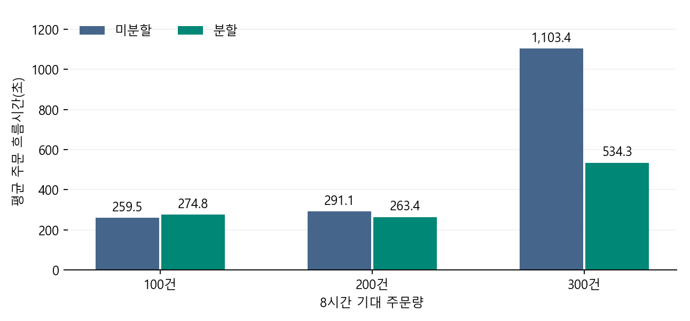

  
# 부품창고 시뮬레이션을 활용한 주문 흐름시간 분석

**2026년 2학기 시뮬레이션 텀 프로젝트 - Stage3(AS-IS)**

정비부품 창고에서 같은 주문에 자주 쓰이는 부품을 한 보관 상자(토트)의 여러 구획에 나눠 담으면, 로봇이 한 번에 여러 부품을 가져올 수 있다. 

**운반 횟수가 줄면 주문도 빨리 끝날까?** 자동창고 로봇(ACR)이 토트를 인출해 피킹 작업대로 운반하는 현행 시스템을 대상으로 이 질문을 실험했다.

로봇 2대가 토트 4개를 모아 출발하는 조건에서, 토트 분할은 8시간 기대 주문량이 100건일 때 평균 주문 흐름시간을 **5.9% 늘렸고**, 300건일 때는 **51.6% 줄였다**.

이 차이를 설명하기 위해 운반 횟수와 배치가 다 차기 전에 출발한 횟수를 함께 살폈다.

  

## 실험 설계

BMW 정비 청구 기록을 바탕으로 통합 주문 222종을 구성했다. 주문 흐름시간은 **주문 발생부터 마지막 필요 부품의 피킹 완료까지**로 정의했다.

| 실험 요인 | 설정 |
| --- | --- |
| 수요 | 8시간 기대 주문량 100·200·300건 |
| 토트 보관 | 미분할 또는 분할. 두 방식의 총 토트 수(3,000개)와 품목별 재고를 동일하게 설정 |
| 최소 출발 배치(B) | 1~8개. 설정 수량이 모이거나 대기 제한시간이 지나면 출발 |
| ACR 대수 | 1~4대. 피킹 작업자는 1명으로 고정 |

30일 단위 실험을 20회 반복했다. 주요 지표는 평균 주문 흐름시간이며 처리량, 미완료 주문 수, 로봇 운행 및 대기 지표를 함께 확인했다.

## 1. 수요가 낮으면 운반 횟수가 줄어도 주문은 늦어질 수 있다

| 8시간 기대 주문량 | 미분할 | 분할 | 미분할 대비 변화 |
| --- | ---: | ---: | ---: |
| 100건 | 259.5초 | 274.8초 | +5.9% |
| 200건 | 291.1초 | 263.4초 | −9.5% |
| 300건 | 1,103.4초 | 534.3초 | −51.6% |

100건 조건에서는 분할 후 평균 반출 운행 횟수가 855.9회에서 814.2회로 줄었다. 반면 제한시간 만료로 출발한 횟수는 477.6회에서 496.9회로 늘었다. 주문이 드문 상황에서는 한 주문에 필요한 토트가 줄어도 남은 배치를 채우려고 다음 주문을 기다릴 수 있다.

이원분산분석 결과, 평균 흐름시간에 대한 **토트 분할 여부와 최소 출발 배치의 교호작용**이 유의했다(F=19.7, p<0.001). 

분할의 효과는 함께 적용하는 출발 기준에 따라 달라졌다. 같은 검정에서 처리량과 미완료 주문 수의 교호작용은 유의하지 않았다.

## 2. 모든 조건에 같은 배치를 쓴다면 무엇을 우선할까?

수요와 로봇 대수에 따라 평균 흐름시간이 가장 짧은 배치가 달랐다. 하나의 설정을 계속 쓸 때에는 조건별 최적 배치 대비 시간이 얼마나 늘어나는지와, 주문이 처리 능력을 넘어 계속 쌓이는 조건이 몇 개인지를 비교했다.

| 공통 최소 배치 | 처리능력 초과 조건 수 | 조건별 최적 배치 대비 평균 흐름시간 증가율 |
| --- | ---: | ---: |
| 2개 | 3 | +31% |
| 7개 | 0 | +72% |
| 8개 | 0 | +78% |

배치 2개는 평균 시간 손실이 가장 작았지만 세 조건에서 주문 적체가 지속됐다. 공통 설정으로 적체 방지를 우선하면, 초과 조건이 없었던 7개와 8개 중 **7개**의 시간 손실이 작았다. 수요에 따라 설정을 바꿀 수 있다면 조건별 배치를 쓰는 편이 응답시간 면에서 유리하다. [배치 1~8개 전체 결과 CSV](results/fixed-batch.csv)

## 3. 로봇을 한 대 더 투입할 때의 효과

각 조건에서 가장 짧은 평균 흐름시간을 보인 배치를 적용하면, 8시간 기대 주문량 200건에서 **분할·로봇 3대**와 **미분할·로봇 4대**의 평균 흐름시간은 모두 약 3.3분이었다. 300건 조건에서도 두 구성은 각각 약 5.1분이었다.

반대로 저수요(100건)의 분할 방식에서는 3대에서 4대로 늘려도 단축률이 0.8%였다(대응표본 t검정, Holm 보정 p<0.001). 증설 여부를 판단할 때에는 수요별 단축 폭과 배치 조정으로 얻을 수 있는 효과를 함께 살펴야 한다.

## 4. 발표 자료

[Stage3 |  실험 설계·분석·결론 발췌 (원본 17–25쪽)](docs/experiment-results.pdf)
 
[Stage3 | 발표 전체 pdf](docs/PS3_발표자료_1조.pdf)

Stage3(As-Is)에서는 모델링과 실험설계, 분석(1), PPT 제작을 담당했다.
